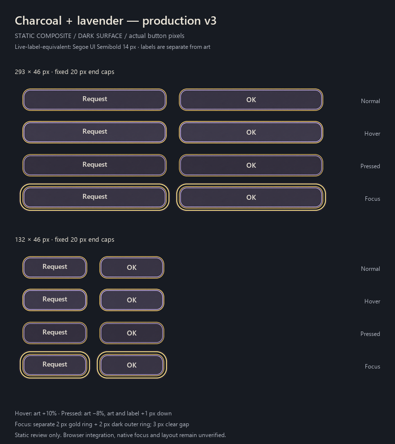
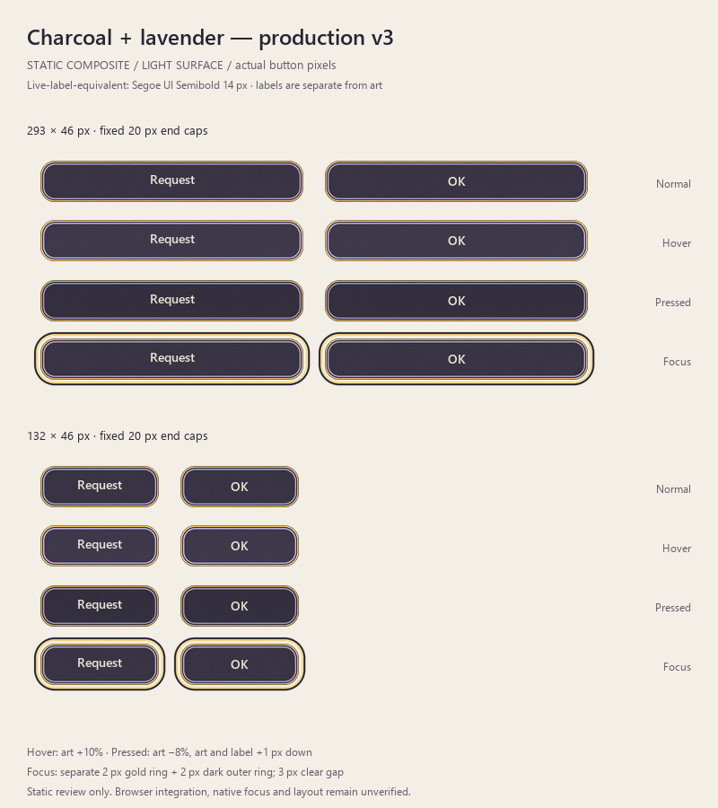

PMG UI Asset Artist — Asset Review & Production.

Verdict: production-ready as an art asset. In-game browser integration remains unverified.

Production cleanup was performed by GPT-6.1 Sol at High effort, with final visual review by the parent reviewer. Read AGENTS.md and the imagegen skill. Inspected the approved charcoal-lavender-background-v2.png and its mockup. A constrained built-in imagegen edit retained fringe and strengthened the gold, so that variant was rejected. The final candidate is a deterministic production export from the approved original: exterior alpha sanitation, padding removal, alpha-aware downsampling, center-only width adjustment, and PNG optimization. No new concept or interior repaint.

## Deliverables

All paths below are relative to this report's directory:
C:/Users/Toska/Documents/GitHub/PMG/research/art/request-ok-pilot-2026-10-22/

| File | Pixels | Bytes | Purpose |
|---|---:|---:|---|
| charcoal-lavender-production-v3-2x.png | 264 × 92 | 25,266 | Primary blank RGBA production candidate |
| charcoal-lavender-production-v3-293x46.png | 293 × 46 | 11,846 | Native desktop blank reference export |
| charcoal-lavender-production-v3-132x46.png | 132 × 46 | 6,937 | Native phone blank reference export |
| production-preview-dark.png | 800 × 900 | 124,644 | Static state sheet, dark surface |
| production-preview-light.png | 800 × 900 | 125,056 | Static state sheet, light surface |
| production-alpha-inspection.png | 960 × 640 | 46,536 | Native and enlarged edge checks over dark and white |
| production-preview.html | — | 43,775 | Standalone programmer preview with actual DOM labels and separate focus styling |
| production-checks.json | — | 2,717 | Numeric checks and approved-original hashes |
| production-export.py | — | 11,748 | Reproducible production export and static preview authoring helper |

## Exact scaling handoff

Use the 264 × 92 primary PNG as a 2× source. Use fixed-height horizontal THREE-SLICE scaling, an equivalent to nine-slice that preserves the complete rounded ends. Target display height is always 46 CSS px.

Source ranges are half-open:
- Left cap: x [0,40), y [0,92): 40 × 92 source pixels -> 20 × 46 CSS pixels.
- Center: x [40,224), y [0,92): 184 × 92 source pixels -> stretch horizontally only.
- Right cap: x [224,264), y [0,92): 40 × 92 source pixels -> 20 × 46 CSS pixels.

At 293 × 46: left20 + center253 + right20.
At 132 × 46: left20 + center92 + right20.

Do not resize the whole PNG to 293 × 46. That would widen the rounded ends and distort the border. End caps must remain20 CSS px wide at both requested widths. Source art first reduced naturally to528 × 92, then only its quiet center compressed into the264 × 92 canonical source. No end-cap width compression was used for the canonical source. For other button heights, prepare a matching export or uniformly scale all slice measurements rather than changing height alone.

The standalone HTML demonstrates a20px / flexible-center /20px layout. Full source maps to132px ×46px at native2x reduction. The center layer enlarges the background proportionally in X (132/92 =143.47826087% of its own width), centered, to isolate and stretch only the original92px center. Caps use left/right background positioning at132px ×46px. Labels are separate text nodes above the decorative layers.

## Cleanup and verification

- Approved original and original mockup SHA-256 hashes remain unchanged (see production-checks.json).
- Original visible-art crop: [22,166,2150,537), 2128 ×371 px. Excess transparent canvas removed.
- Source alpha below128 discarded; retained silhouette alpha normalized to255; RGB retained inside the silhouette. Reduction used alpha-aware Lanczos. Export alpha<=8 is zeroed to remove faint resampling ringing, and fully transparent RGB is also zeroed.
- All three blank outputs are RGBA, alpha range0–255. Visible bounds touch the canvas extents; no excess rectangular padding remains. Rounded-corner transparency remains.
- Blank PNGs contain no words, icons, character art, or focus ring.
- Left and right rendered caps are pixel-identical between293 ×46 and132 ×46.
- Native-size and4× enlarged edge previews inspected over dark and white surfaces. No visible colored fringe or detached noise remains at the target sizes. The4× image uses nearest-neighbor enlargement to expose the native pixel structure.
- Charcoal center, lavender inner rim and gold border retained. Center remains quiet and blank.
- Both Request and OK are shown at14px Segoe UI Semibold in cream #eee8db, at both sizes, in all four states.
- Minimum measured contrast in the sampled label area is9.59:1 normal,8.87:1 hover,10.35:1 pressed, at both widths. This is a targeted raster label-area measurement, not a full application accessibility audit.
- Primary PNG is96.7% smaller than the765,547-byte approved draft.

## Interaction treatment

Focus is deliberately outside the PNG. The preview uses a separate2px gold ring plus2px dark outer outline, with a3px clear gap; this works on light and dark surfaces. Keep this as a UI layer/outline. Provide clearance around the button so the focus treatment is not clipped.

Hover: decorative art brightness+10%; live text unchanged.
Pressed: decorative art brightness−8%; art and live label move down1px.
Normal and focus: normal art colors; focus adds the external ring only.
Keep the46px click target; position shifts apply to visual layers, not the layout or target.

## Static preview limitation

The PNG state sheets are STATIC COMPOSITES at the requested button pixel sizes. They are not screenshots of the running game. The standalone HTML provides actual DOM labels and CSS state treatments, but was not opened or verified in a browser: local-file browser access was unavailable/blocked, and no workaround was attempted.

Remaining in-game checks: browser sampling of the three-slice joins at different device-pixel ratios and zoom levels; actual inherited font placement and computed colors; pointer hover/press behavior; keyboard tab order and focus-visible activation; focus-ring clipping in the real dialog; and the actual click target/accessible names. No claim of live UI verification is made.

## Scope

All project writes were confined to this art-draft directory. Game code, data, current assets and playable HTML were read-only. No integration, build, commit, push or publication was performed.

